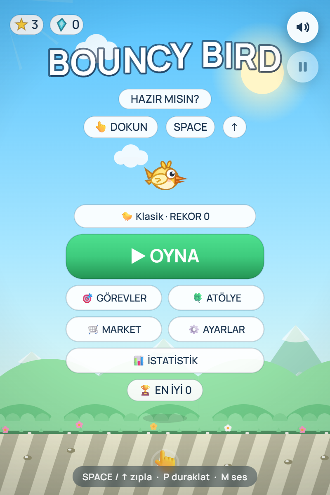
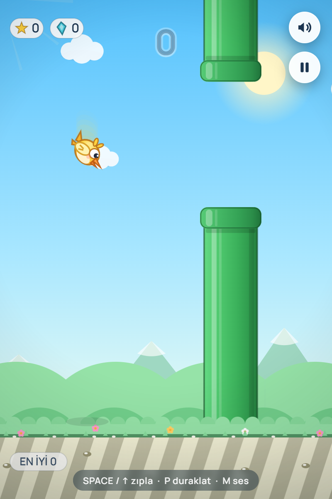
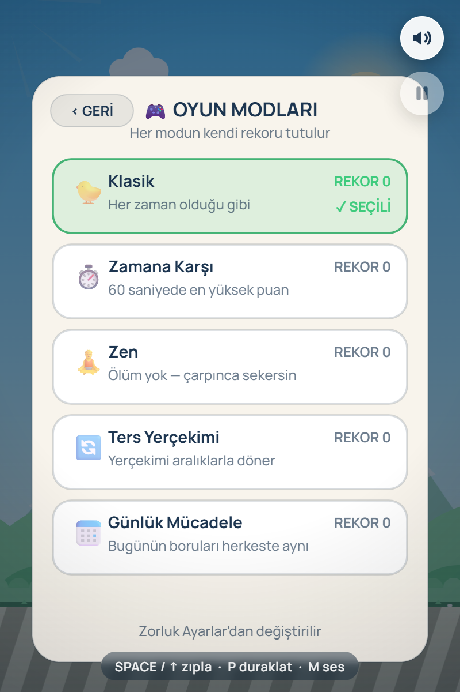

# 🐤 Bouncy Bird

> **Bouncy Bird**, harici hiçbir kütüphane veya görsel/ses dosyası barındırmayan, tamamen prosedürel grafik ve ses motoruna sahip, modern ve yüksek performanslı bir tek dosya (single-file) web oyunudur.

---

## 🎮 Canlı Önizleme

Oyunu herhangi bir modern tarayıcıda hemen oynamak için:  
👉 **[hextr0.github.io/bouncy-bird](https://hextr0.github.io/bouncy-bird/)**

---

## 📸 Ekran Görüntüleri

  
  
  

---

## ✨ Öne Çıkan Özellikler

### 🕹️ Oyun Modları
* **Klasik:** Alışılmış, zorlayıcı arcade deneyimi.
* **Zamana Karşı (60s):** 60 saniyelik geri sayımda en yüksek skoru yapma mücadelesi.
* **Zen Modu:** Çarpışma ölümünün olmadığı, engellerden sekerek rahatlatan mod.
* **Ters Yerçekimi:** Belirli aralıklarla fizik kurallarının tersine döndüğü dinamik mod.
* **Günlük Mücadele:** Deterministik tohumlama (seeded PRNG) sayesinde günün her anı dünya genelinde tüm oyuncularda birebir aynı boru dizilimini sunan mod.

### 🐉 Boss Savaşları & Dinamik Olaylar
* Dinamik can barları, faz geçişleri ve mermi fırlatma mekaniğine sahip ejderha savaşları.
* Hızlandırıcı portallar, rüzgâr akımları ve güçlendiriciler (Kalkan, Mıknatıs, 2x Puan, Ağır Çekim).

### 🎨 Prosedürel Kozmetik & Ekonomi
* **13+ Karakter Skini:** Robot, Anka Kuşu, Galaksi, Penguen, Hayalet ve dahası (tamamı Canvas API ile matematiksel çizilir).
* **Kişiselleştirme:** 8 farklı arka plan teması, 6 dinamik parçacık izi (trail) ve özel boru desenleri.
* **Şans Atölyesi:** Çarkıfelek, şans yumurtası, kart açma ve yazı-tura mini oyunları.

### 📱 Çevrimdışı PWA & Haptik Motoru
* **%100 Offline Çalışabilirlik:** İlk yüklemeden sonra internet bağlantısı kesilse dahi Service Worker önbelleği ile bağımsız çalışır.
* **Haptik Geri Bildirim:** Zıplama, vuruş ve çarpışmalarda mobil cihazın titreşim motorunu kullanan dokunsal tepki sistemi.
* **Masaüstü & Mobil Kurulum:** iOS ve Android'de tek tıkla ana ekrana eklenebilir, bağımsız tam ekran uygulama olarak çalışır.

### 📡 Proximity & Web NFC Entegrasyonu
* **Yakındakine At (Proximity Share):** İki telefon birbirine yaklaştırıldığında veya dokundurulduğunda (iOS AirDrop/NameDrop veya Android Quick Share) oyunu anında yerel ağdan iletme.
* **Web NFC Desteği:** `NDEFReader` ve `NDEFWriter` API'leri üzerinden oyun bağlantısını veya `FPS3` kayıt kodunu fiziksel NFC kartlarına/etiketlerine yazıp okuma.
* **Cihazlar Arası Bulutsuz Aktarım:** Kayıt verilerini kamera QR taraması ile senkronize eden, CRC32 ve bitmask sıkıştırmalı yerel save motoru.

---

## 🛠️ Teknik Mimari

* **Görsel Motor:** Pure Canvas 2D API (Sıfır PNG/JPG/SVG varlığı, tüm dünya ve karakterler vektörel/matematiksel oluşturulur).
* **Ses Motor:** Web Audio API (Harici ses dosyası yoktur; tüm zıplama, patlama, vuruş ve müzikler osilatör frekansları ve gürültü düğümleriyle gerçek zamanlı sentezlenir).
* **Durum & Kayıt:** `FPS3` formatı (Bitmask + Varint sıkıştırma, Base43 kodlama ve IEEE 802.3 CRC-32 sağlama toplamı).
* **Dağıtım Boyutu:** Tek sayfalık, sıfır harici bağımlılığa sahip ultra hafif yapı.

---

## ⌨️ Kontroller

| Platform | Eylem | Kontrol |
| :--- | :--- | :--- |
| **Mobil** | Zıpla / Havalan | Ekrana Dokunma *(Haptik Titreşimli)* |
| **Masaüstü** | Zıpla / Havalan | `Space` veya `Yukarı Ok (↑)` |
| **Masaüstü** | Duraklat / Devam | `P` veya `Escape` |
| **Masaüstü** | Ses Aç / Kapat | `M` |

---

## 📄 Lisans

Bu proje [MIT Lisansı](LICENSE) kapsamında açık kaynak olarak sunulmaktadır.
